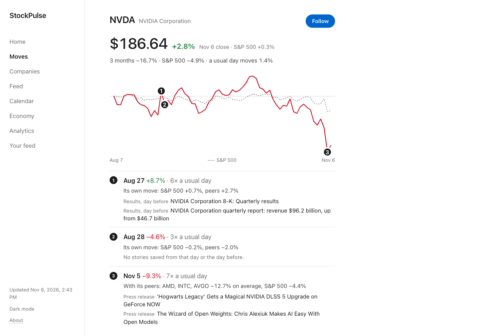
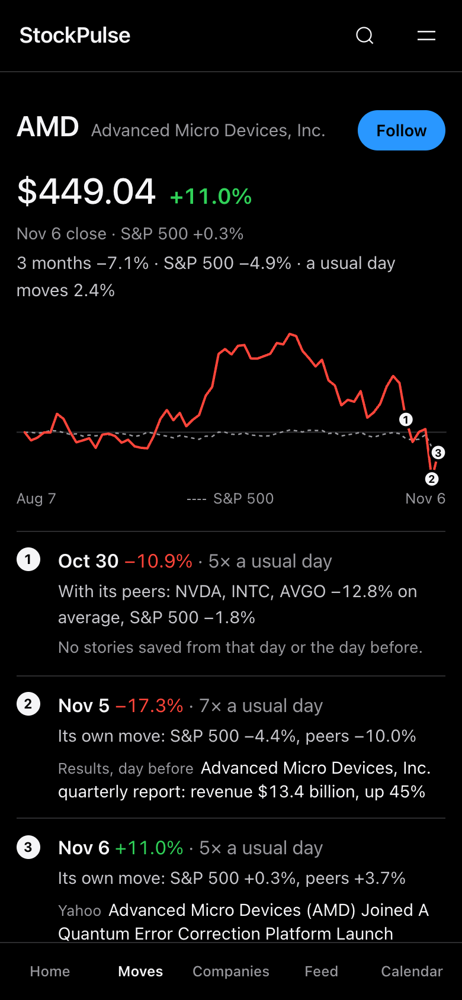

# StockPulse

**A free, calm way to follow companies through what they actually publish:** their SEC filings, results, press releases and the news about them, with every number checked against its source.

**Live site: [stock-news-dashboard.pages.dev](https://stock-news-dashboard.pages.dev)**. No accounts, no ads, no tracking.

<p>
  
  
</p>

## What it does

It follows the S&P 100 (100 large US companies) and updates every morning.

- **Moves** shows one card per company, the ones that stood out from the market most first. Each card marks the company's biggest days and says whether each was **its own move, the market's, or its peers'**, with the numbers, then lists what was published that day. It never claims a story caused a move.
- **Feed** shows stories from the last 30 days, most important first. News that never names the company it's filed under, and stock-picking listicles, sink to the bottom.
- **Company pages** show results read straight from 10-Q and 10-K filings, insider trades, press releases, upcoming dates, customers, suppliers and competitors, and three months against peers and the S&P 500.
- **Calendar** lists earnings calls, dividends and filing deadlines.
- **Economy** shows the Fed rate, the 10-year yield, inflation, oil and unemployment from FRED, and when the next releases are due.
- **For you** covers the companies and sectors you follow, and can learn from what you read. All of that stays in your browser.

## Where the data comes from

| What | Source |
|---|---|
| Filings, results figures, insider trades, company names | [SEC EDGAR](https://www.sec.gov/edgar) |
| Press releases | Each company's own newsroom feed |
| News, earnings dates, ticker lookup | [Finnhub](https://finnhub.io) (free plan) |
| Stock prices | Yahoo Finance |
| Economy figures | [FRED](https://fred.stlouisfed.org), Federal Reserve Bank of St. Louis |
| Economic release dates | Federal Reserve, Bureau of Labor Statistics, Energy Information Administration |
| One-line summaries | Google Gemini (free tier). A summary is thrown out if it has a number its source doesn't. |

A figure only appears if it was read from its source. When a source can't be reached, the site keeps the last real reading with its date, or shows nothing.

## How it works

A Python pipeline runs on GitHub Actions every morning:

1. **Collect** filings, press releases and news, and read the figures out of each filing.
2. **Clean up:** remove duplicates, classify and score each story, and link companies to their customers and suppliers.
3. **Summarise** the important stories with Gemini.
4. **Build** a static site with Jinja templates and deploy it to Cloudflare Pages.

There's no server, database host or build step. SQLite is carried between runs in the Actions cache, and the pages are plain HTML, CSS and JavaScript under a strict Content Security Policy.

## Run it yourself

```bash
git clone https://github.com/lucasdt416-design/stock-news-dashboard.git
cd stock-news-dashboard
python3 -m venv .venv && source .venv/bin/activate
pip install -r requirements.txt

python scripts/run_local.py     # collect, score and build into site/
open site/index.html
```

It works without any keys, but some parts fill in only with a key:

| Variable | What it adds |
|---|---|
| `FINNHUB_API_KEY` | News articles, earnings dates and the live ticker lookup |
| `GEMINI_API_KEY` | One-line summaries. Optional: `GEMINI_MODEL` pins a model, and `GEMINI_MAX_BATCHES` (default 12) caps requests per run |
| `SEC_EDGAR_USER_AGENT` | Your contact string for SEC requests, which the SEC asks for |

`python scripts/build_demo.py` builds a demo site from made-up stories with no network or keys, which is handy for working on the design.

### Add companies

Names, SEC numbers and sectors come from the SEC's free lists:

```bash
python scripts/add_companies.py PEP NFLX LLY --dry-run   # look first
python scripts/add_companies.py PEP NFLX LLY             # then add to data/watchlist.yaml
```

Each company gets its own page, and Finnhub calls are paced to the free plan's limit.

### Deploy your own copy

Fork the repo, then add these repository secrets:
- `CLOUDFLARE_API_TOKEN`
- `CLOUDFLARE_ACCOUNT_ID`
- `CLOUDFLARE_PROJECT_NAME`
- optionally, the keys above

[`daily-run.yml`](.github/workflows/daily-run.yml) runs every day at 11:00 UTC and on demand.

## Tests

```bash
pip install -r requirements-dev.txt
pytest                                   # about 300 tests
python scripts/check_following.py       # walks through the site in a real browser (Playwright)
```

## Not investment advice

Everything here is for information only. Prices and figures can be late or wrong, so check the linked source before relying on anything.

## License

[MIT](LICENSE)
